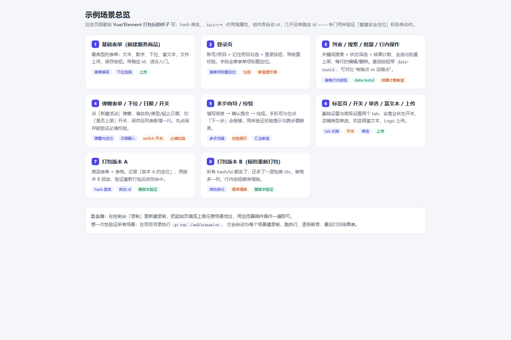
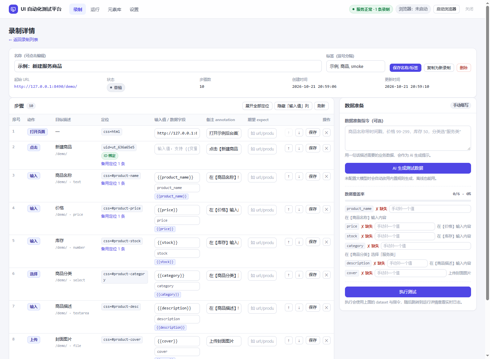
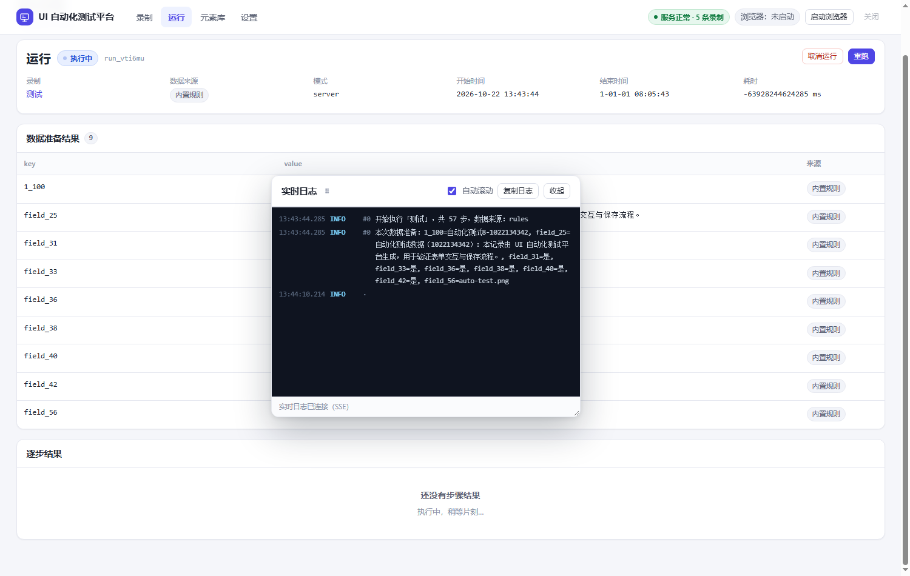
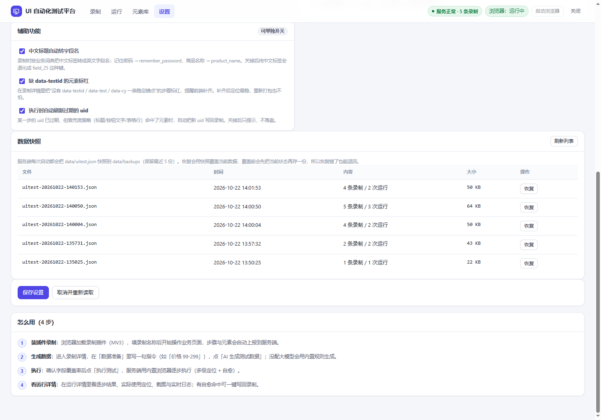

# UI 自动化测试平台（Golang 服务端 + 浏览器插件录制）

> 在业务页面上**正常点一遍**，就得到一条可回放的测试流程：自动生成测试数据 → 内置浏览器逐步执行 →
> 每步显示实际用的定位、失败截图与实时日志。页面用 Vue/React 重新打包也不怕，定位只认业务语义。

<p>


</p>
<p>


</p>

| 文档 | 内容 |
|---|---|
| **[docs/GUIDE.md](docs/GUIDE.md)** | **完整使用手册**：安装 → 录制 → 生成数据 → 执行 → 看日志 → 排错 FAQ → 验收清单 |
| [docs/API.md](docs/API.md) | 全部 HTTP 接口（字段以此为准，插件与控制台都按它实现） |
| `http://127.0.0.1:8490/demo/gallery.html` | 8 个示例场景（都按 Vue 打包后的样子写），控制台顶部「示例场景 ↗」直达 |

---

## 一、5 分钟上手

```powershell
cd uitest
go build -o uitest-server.exe .      # 只依赖 gorilla/websocket，离线可构建
.\start.ps1                          # 或直接 .\uitest-server.exe
```

1. 打开 <http://127.0.0.1:8490>；
2. 装插件：`edge://extensions` → 开发人员模式 → 加载解压缩的扩展 → 选 `uitest\extension`；
3. 「录制」→ 新建录制 → 填名称和起始页（可先用 `http://127.0.0.1:8490/demo/admin-list.html`）
   → 开始录制 → 回业务页正常操作 → 停止录制；
4. 录制详情右侧「数据准备」写一句 `价格 99-299，库存 50` → 「AI 生成测试数据」（没配大模型用内置规则）；
5. 点「执行测试」→ 运行详情看逐步结果与实时日志。

更细的每一步、每个字段、每个报错处理见 **[docs/GUIDE.md](docs/GUIDE.md)**。

---

## 二、能做什么

| 能力 | 说明 |
|---|---|
| **录制即脚本** | 插件把点击/输入/选择/勾选/上传/断言实时上报；每步自动生成中文备注 |
| **稳定 ID 绑定** | 录制时算 `data-uitest-id`（确定性算法），执行优先用它；失效时 5 级语义兜底 + 指纹自愈 |
| **重新打包安全** | hash 类名、`data-v-*`、组件库自动 id 全部过滤，只认表单项标题/按钮文字/表格行等业务语义 |
| **AI 数据准备** | OpenAI 兼容接口生成；未配置或失败自动退到内置规则（能听懂「价格 99-299」这类指令） |
| **多级兜底 + 自愈回写** | `uid → attr → id/name → label → near → role → cell → text → placeholder → css → xpath`；自愈命中的定位可一键写回录制 |
| **一键刷新定位** | 老录制（只有 css 定位）一次升级成全量 uid，且**语义优先**重算，不会把有歧义的 css 固化 |
| **实时日志** | SSE 推送，悬浮窗默认浮动、可拖动缩放、可复制；断流自动退轮询 |
| **可配置收尾** | 运行结束按设置关标签页 / 关浏览器 / 保留现场（`after_run`） |
| **列表分页 + 批量操作** | 录制/运行/元素库三个列表统一分页（每页条数可记住）、多选、批量删除、清空全部（接口层 `?all=1` 双重确认） |
| **数据快照** | 每次启动留快照，误删可一键恢复（恢复前自动再存一份） |

---

## 三、示例场景库（8 个）

控制台顶部「示例场景 ↗」→ `/demo/gallery.html`。所有页面都故意做成 hash 类名 + `data-v-*` + 自动 id，
几乎没有稳定 id，专门用来验证定位与各种动作：

| # | 场景 | 地址 | 覆盖 |
|---|---|---|---|
| 1 | 基础表单（新建服务商品） | `/demo/` | 填写、下拉、富文本、上传、保存 |
| 2 | 登录页 | `/demo/login.html` | 表单项标题定位、勾选、断言提示语 |
| 3 | 列表 / 搜索 / 批量 / 行内操作 | `/demo/admin-list.html` | `placeholder`、`attr`(data-testid)、`cell`(行+按钮)、计数断言 |
| 4 | 弹窗表单 / 下拉 / 日期 / 开关 | `/demo/admin-dialog.html` | 弹窗内定位、日期、switch、必填校验 |
| 5 | 多步向导 / 校验 | `/demo/wizard.html` | 多步流程、校验提示、跨步骤断言 |
| 6 | 标签页 / 开关 / 单选 / 富文本 / 上传 | `/demo/settings-tabs.html` | `role=tab`、开关、单选、上传 |
| 7 | 打包版本 A | `/demo/vue-v1.html` | hash 类名 + 自动 id 的原始版本 |
| 8 | 打包版本 B（模拟重新打包） | `/demo/vue-v2.html` | hash/id 全变、多一层包装、多一列、按钮顺序调换 |

### 一键跑全部场景

```powershell
go run ./cmd/scenarios            # 跑全部
go run ./cmd/scenarios -only 登录  # 只跑名字含"登录"的
go run ./cmd/scenarios -keep      # 保留生成的录制，方便在控制台逐条看
```

```
场景                                     结果    步骤
1 基础表单（新建服务商品）                 PASS   10/10
2 登录页（勾选 / 断言提示）                PASS    6/6
3 列表 / 搜索 / 行内操作                   PASS   10/10
4 弹窗表单 / 日期 / 开关 / 校验            PASS   11/11
5 多步向导 / 校验提示                      PASS   10/10
6 标签页 / 开关 / 富文本 / 上传            PASS    9/9
7 重新打包后仍命中（A 录制 → B 回放）       PASS    7/7
场景结果：7/7 通过 ✅
```

---

## 四、定位原理（摘要）

完整原理、策略表与三个工程细节见 [GUIDE 第 8 章](docs/GUIDE.md#8-定位机制详解)。

```
uid(data-uitest-id，确定性算法)
  → attr(data-testid / data-test / data-cy)
  → id / name（仅当"看起来稳定"，hash 与自动 id 会被过滤）
  → label(表单项标题) → near(标题→同一表单项里的控件)
  → role(角色+按钮文字) → cell(表格行文字+按钮文字)
  → text → placeholder → css(纯结构，不含 class) → xpath
全失败 → 元素指纹自愈打分（唯一最高分且 ≥5 分才认）+ 可写回录制
```

- **过滤打包产物**：`.product-card_1a2b3c`、`.css-9f8e7d`、`data-v-7ba5bd90`、`el-id-3812-12`、`:r1:`、`input-3` 都不参与定位。
- **表格行指纹**用行首单元格文字（改版加一列也不会漂）。
- **控制台标注稳定性**：每个定位带 `稳 / 中 / 弱` 徽章；缺 `data-testid` 的元素标红并在顶部汇总，
  清单可以直接甩给前端补锚点。

---

## 五、目录结构

```
uitest/
├─ main.go                    # 入口：配置合并、embed web/demo、路由装配
├─ internal/
│  ├─ api/                    # HTTP 接口（录制/步骤/运行/元素/设置/备份/SSE）
│  ├─ browser/                # 内置浏览器：启动自愈、CDP 页面操作
│  ├─ cdp/                    # 极简 CDP 客户端（WebSocket + 请求/事件）
│  ├─ engine/                 # 执行器：步骤执行、变量替换、自愈回写、一键刷新定位
│  ├─ ai/                     # AI/规则数据生成
│  ├─ keyname/                # 中文业务标签 → 英文字段名词典
│  ├─ model/ store/ config/   # 数据模型、JSON 持久化（含快照）、配置
│  └─ bus/                    # 事件总线（SSE 实时日志）
├─ runtime/uitest-keys.js     # ★ 浏览器侧共享运行时（定位/动作的唯一实现，go:embed）
├─ extension/                 # MV3 录制插件（与 runtime 共用同一份 uitest-keys.js）
├─ web/                       # 控制台（原生 JS + CSS，无构建步骤，go:embed）
├─ demo/                      # 8 个示例场景页面（全部按"Vue 打包后"写）
├─ cmd/scenarios/             # 一键跑全部示例场景的验证工具
├─ scripts/                   # smoke.ps1（单流程自检）、fetch-browser.ps1（下载内核）
└─ docs/                      # GUIDE.md（使用手册）、API.md、screenshots/
```

---

## 六、自检与验收

```powershell
# 单条流程 + 自愈 + 回写
powershell -ExecutionPolicy Bypass -File scripts\smoke.ps1     # → 自检通过 ✅

# 7 个示例场景（63 步）
go run ./cmd/scenarios                                          # → 场景结果：7/7 通过

# 浏览器健康
curl.exe -s "http://127.0.0.1:8490/api/browser/diagnose?url=http://127.0.0.1:8490/demo/"
```

界面里也可以点「设置 → 内置浏览器 → 诊断浏览器」，会输出内核路径、启动参数、页面标题、
readyState、诊断结论和浏览器日志尾部 —— **"页面打不开 / 白屏"先点它**。

---

## 七、已知限制

1. 插件内容脚本只在页面加载时注入 —— 装/更新插件后需要刷新被测页面。
2. iframe 里的操作会记录 `locator.frame_url`，但执行器以主框架为主，跨 iframe 步骤建议人工确认。
3. 富文本（Quill / ProseMirror 等 contenteditable）可能不触发原生 `input`，取值可能不准。
4. 文件上传：插件只录到文件名；执行时用数据准备里的值当本地路径，没有就用内置生成的示例 PNG。
5. 内联样式/画布类组件（图章、拖拽排序画布）目前只能定位到容器，做不到像素级操作。
6. 运行记录默认保留最近 200 条（`config.json` 的 `storage.keep_runs`）。
7. 单机单进程：不搞多租户、不做并发编排（可并行多个 run，但共享一个浏览器进程）。
8. 内置浏览器只能访问**这台机器能访问的网络**：离线/内网环境打开外网站点必然失败，这是网络限制。

---

## 八、环境变量

| 变量 | 作用 |
|---|---|
| `UITEST_PORT` | 监听端口（默认 8490） |
| `UITEST_HOST` | 监听地址（默认 127.0.0.1） |
| `UITEST_DATA_DIR` | 数据目录（默认 `data`） |
| `UITEST_BROWSER` | 浏览器可执行文件路径 |
| `UITEST_HEADLESS` | `1` = 无头 |
| `UITEST_AI_BASE_URL` / `UITEST_AI_KEY` / `UITEST_AI_MODEL` | AI 数据生成配置 |

---

## 九、常用接口速查

| 方法 | 路径 | 用途 |
|---|---|---|
| POST | `/api/recordings` | 新建录制 |
| POST | `/api/recordings/{id}/steps` | 追加步骤 |
| POST | `/api/recordings/{id}/rebind` | 一键刷新定位（重算 uid） |
| POST | `/api/ai/dataset` | 生成测试数据 |
| POST | `/api/runs` | 执行一次 |
| GET | `/api/runs/{id}` | 运行详情（逐步结果 + 日志） |
| GET | `/api/runs/{id}/events` | SSE 实时日志 |
| POST | `/api/runs/{id}/heal` | 自愈定位写回录制 |
| GET/PUT | `/api/settings` | 设置（含 `browser.after_run`、`assist`） |
| GET | `/api/backups` · POST `/api/backups/{name}/restore` | 数据快照 / 恢复 |

完整字段见 [docs/API.md](docs/API.md)。
